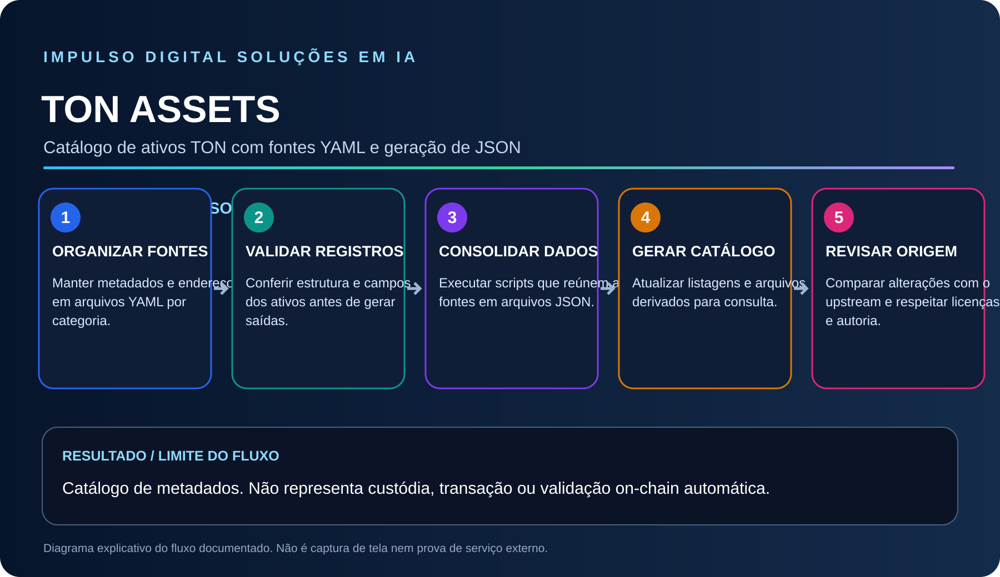
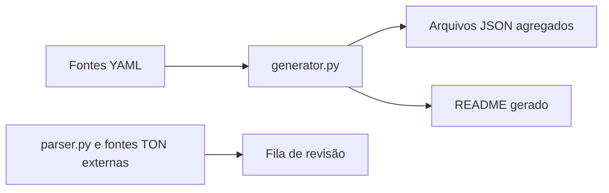

 |  | 

# TON Assets — Fork de Catálogo de Ativos

> Este repositório é um fork de [tonkeeper/ton-assets](https://github.com/tonkeeper/ton-assets). Consulte os avisos de autoria, os termos do upstream e a origem dos ativos antes de reutilizar ou redistribuir.

## Visão geral

Repositório de dados e scripts para catalogar endereços/ativos da rede TON: arquivos YAML organizados por jettons, contas e coleções são consolidados em JSON e usados para gerar uma listagem README. O código também contém parser auxiliar para importar rótulos TON a uma fila de revisão. O README atual, porém, descreve soberania digital/IA e não explica esse propósito que se verifica nos arquivos e no template do gerador.

## Objetivo e valor

**Problema/escopo:** Listas de endereços e metadados de jettons, contas e coleções da TON, com fontes YAML e geração de arquivos JSON.

**Valor verificável hoje:** o repositório torna explícitos seus artefatos, interfaces e limitações para que mantenedores e contribuidores possam avaliar o que existe sem confundir demonstração, proposta e produção.

## Arquitetura e tecnologias

Não documentada no README atual. Pela árvore, scripts e workflows: accounts/, collections/ e jettons/ contêm fontes YAML; generator.py lê essas fontes, normaliza endereços, consulta fontes externas para alguns ativos e produz accounts.json, collections.json, jettons.json e README.md a partir de readme.md.template. parser.py é um fluxo distinto que clona ton-studio/ton-labels, consulta TON API e popula a área to_review/. Workflows executam esses scripts; não há evidência de serviço web ou biblioteca pública.

- Python (linguagem reportada pelo GitHub e confirmada pelos scripts).
- YAML como fontes de dados e JSON como arquivos agregados/gerados.
- Dependências declaradas: pydantic 1.9.2, pyyaml 6.0.1, requests 2.27.1 e urllib3 ~=1.26.20.
- GitHub Actions para reconstrução automatizada, execução manual do parser e verificações de fonte.
- Integrações externas codificadas: APIs de STON.fi, DeDust e Backed.fi no gerador; ton-studio/ton-labels e TON API no parser.
- Não há manifesto de pacote de aplicação; requirements.txt é o manifesto Python visível.

## Início rápido

Os comandos abaixo refletem instruções, manifestos ou pontos de entrada presentes no repositório. Dependências externas, segredos e serviços estão indicados quando aplicável; a presença de um comando não equivale a uma execução validada.

1. O README atual não fornece comandos de instalação ou uso.
2. Comandos comprovados em .github/workflows/rebuild-src.yml: pip3 install -r requirements.txt e python3 generator.py. O workflow os executa em runner Ubuntu; não há execução local registrada.
3. python3 parser.py também consta em workflow_dispatch de parse-ton-labels.yml, mas depende de acesso à rede e de fontes externas; não é necessário para gerar os JSON principais.

## Exemplo de uso

Exemplo compatível com as interfaces reais: adicionar ou editar um arquivo .yaml em jettons/ com campos name, symbol e address (o gerador exige esses campos) e executar python3 generator.py; o gerador consolida jettons.json, além de contas/coleções e README.md. A validação integral depende também das fontes externas consultadas pelo script. O exemplo descreve o código, não um resultado de execução testado na revisão estática do repositório.

## Estado e limitações

**Maturidade indicada:** Fork e demonstração.

- O README de branding não deve ser tomado como evidência de que este código implementa um ecossistema financeiro Aurora, soluções de IA, soberania nacional ou proteção de dados; os arquivos examinados apontam para catálogo de dados TON derivado do projeto tonkeeper/ton-assets.
- LICENSE declara o título MIT, mas termina em reticências e o GitHub não reconhece SPDX; esclarecer licença antes de descrever reutilização/redistribuição como autorizada sob MIT.
- O gerador e o parser fazem chamadas/clonagem de fontes externas; a geração não é necessariamente determinística nem funciona sem rede. O workflow de reconstrução tem agenda periódica e pode gravar arquivos gerados.
- Os comandos foram verificados nas definições públicas dos workflows e scripts, não executados durante a auditoria; não afirmar que a instalação, geração ou validação passou.

## Contribuição

Leia [CONTRIBUTING.md](CONTRIBUTING.md) antes de abrir uma issue ou pull request. Para reportes de segurança, siga a orientação específica do repositório, se houver.

## Licença

Este repositório é um fork e o licenciamento herdado requer revisão: mantenho o arquivo de licença recebido sem declarar permissão sobre material de terceiros. Consulte a origem antes de reutilizar.

## Patrocínio e apoio

O desenvolvimento aberto exige tempo para manutenção, documentação, testes, revisão de contribuições e resposta a issues. Se este projeto for útil, considere apoiar a continuidade pelo [GitHub Sponsors](https://github.com/sponsors/felipetjmg1-bit). O apoio não representa promessa de funcionalidades, prazo de entrega ou suporte comercial.

**Empresa responsável:** Impulso Digital Soluções em IA.

## Fluxo passo a passo

Consulte o [guia textual com as etapas do projeto](docs/PROCESSO-PASSO-A-PASSO.md). O infográfico acima resume visualmente o mesmo fluxo.
